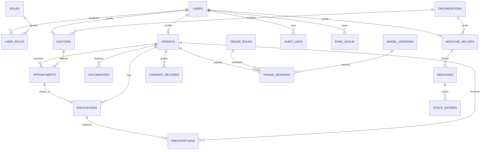
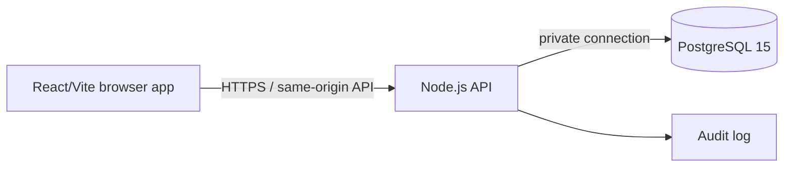

# MediBuddy

MediBuddy is a local development prototype with a React/Vite interface and a Node.js + PostgreSQL backend. The patient, doctor, pharmacy, and admin portals connect to the local API for their implemented workflows. Synthetic records are provided for engineering demonstrations only.

## Local setup

Requirements: Node.js 22+, pnpm (via Corepack), and the configured local PostgreSQL instance. Docker Compose is an alternative.

### One-command local launch

1. Install frontend and backend dependencies: `corepack pnpm install && cd backend && npm ci && npm run build && cd ..`.
2. Copy `.env.example` to `.env` if needed. For local testing, use `NODE_ENV=development`, `API_PORT=3002`, and configure a Resend sender if you want real email OTP delivery.
3. Run `corepack pnpm dev:full` from the repository root and open **http://localhost:5175**. The API health check is **http://localhost:3002/api/health**.
4. Press Ctrl+C to stop. To start again, run `corepack pnpm dev:full`.

Development OTP delivery falls back to a one-time code shown in the sign-in screen when Resend cannot send email. This fallback is disabled in production. Local OTP signup allows choosing any portal role for convenience; production requires provisioned staff roles. Do not use real patient data in this prototype.

`corepack pnpm dev:stop` stops a launcher started with `dev:full`.

1. Copy `.env.example` to `.env` and configure `RESEND_API_KEY` and a verified `RESEND_FROM_EMAIL` for actual email delivery.
2. For a Docker database/API use `docker compose up --build db api`; the standalone Vite server is started with `corepack pnpm dev`. Set the Vite proxy's `API_PORT` to `3001` for this Docker API configuration.
3. Sign-in uses a six-digit, 10-minute email code. Phone is a contact field and is not SMS-verified. Email OTP is limited to one per minute and five per hour per phone/email pair.

For a non-container API process, copy `backend/.env.example` to `backend/.env`, start PostgreSQL with matching credentials, then run `cd backend && npm ci && npm run migrate && npm run dev`. Run frontend Vite separately.

## Backend phase status

### Implemented in Phase 1

- Node.js/TypeScript API in `backend/`, PostgreSQL 15-compatible migration, local Compose service, health check, and OpenAPI JSON document.
- Relational tables for users/roles, patient/doctor/seller profiles, organizations, appointments, encounters, prescriptions, vaccinations, medicines, timestamped stock entries, consent, audit, sync queue, and triage/model metadata.
- Patient-only password registration, Argon2id password hashes, login, short-lived signed access cookies, rotating refresh cookies, logout revocation, and role middleware.
- Email OTP delivery through Resend (with development-only fallback), Argon2id password registration/login, rotating refresh sessions, server-side role checks, and audited patient profile creation. Phone is a contact field and is not phone-verified.
- Appointment requests are persisted in PostgreSQL. Patients can list/request/cancel their own appointments; doctors can list only their assigned appointments, approve/reschedule/cancel them. Reads and writes are audited.
- Patient/doctor records, doctor prescription creation, pharmacy inventory/catalog, and aggregated admin analytics are connected to API endpoints. Synthea physicians can be browsed for demo appointments while their synthetic login identities stay disabled.
- Permission matrix and threat model: [`docs/permission_matrix.md`](docs/permission_matrix.md), [`docs/threat_model.md`](docs/threat_model.md), and [`docs/er_diagram.md`](docs/er_diagram.md).

### Deferred / not implemented

- A streaming, transactional Synthea CSV importer is implemented and has imported the supported files. Header checks, mappings, import results, and rerun instructions are documented in [`docs/synthea_mapping.md`](docs/synthea_mapping.md).
- Full clinical record authoring, consent management UI, dispensing/sales workflow, live video provider, sync, triage, and clinician override endpoints.
- Staff provisioning interface, SMS/phone verification provider, access audit coverage for future clinical endpoints, analytics small-cell suppression implementation, backups, and evaluation results.
- No AI model or clinical rules are active. Triage must never diagnose, prescribe, or replace clinical judgement. Future triage intended use: “Triage guidance for patients and village health workers; does not diagnose, prescribe, or replace a clinician.”

## Synthea data policy and mapping status

The source files currently present under `csv/` are US-derived Synthea synthetic records, suitable for engineering tests only; they cannot establish clinical effectiveness. Actual headers were validated by the importer before reading data. Seven supported files were imported into the local development database; results and limitations are recorded in [`docs/synthea_mapping.md`](docs/synthea_mapping.md). This is synthetic engineering data, not clinically validated data.

| File | Intended destination | Mapping status |
| --- | --- | --- |
| `patients.csv` | `users`, `user_roles`, `patients` | Imported: 1163 patients |
| `providers.csv` | `users`, `user_roles`, `doctors` | Imported: 5056 providers |
| `organizations.csv` | `organizations` | Imported: 1127 organizations |
| `encounters.csv` | `appointments`, `encounters` | Imported: 61,459 completed encounters |
| `medications.csv` | `prescriptions` | Imported: 56,430; stable composite IDs |
| `immunizations.csv` | `vaccinations` | Imported: 17,009; stable composite IDs |
| `conditions.csv` | Village-level aggregated condition counts | Aggregated; groups below five suppressed |
| `observations.csv` | Optional vitals/lab extension | Headers inspected; not imported in Phase 1 |
| `procedures.csv`, `allergies.csv`, `careplans.csv` | Future clinical record extensions | Headers inspected; deferred |

The importer deterministically maps source locations to configured synthetic Uttarakhand villages, stores provenance and source IDs, and uses upserts. The local import reported zero failed rows; rerun behavior is designed to be idempotent.

## API endpoints available now

| Method | Path | Purpose |
| --- | --- | --- |
| `GET` | `/api/health` | API and database readiness |
| `POST` | `/api/auth/register` | Create patient account (password, phone/email) |
| `POST` | `/api/auth/login` | Password login |
| `POST` | `/api/auth/otp/request` | Send a six-digit email verification code through Resend |
| `POST` | `/api/auth/otp/verify` | Verify email code and create/sign in to an account |
| `POST` | `/api/auth/refresh` | Rotate refresh session |
| `POST` | `/api/auth/logout` | Revoke refresh session and clear cookies |
| `GET` | `/api/auth/me` | Read current account and assigned roles |
| `GET` | `/api/doctors` | List active doctors for patient booking |
| `GET` | `/api/appointments/mine` | Patient's own appointments |
| `POST` | `/api/appointments` | Request an appointment |
| `POST` | `/api/appointments/:id/cancel` | Patient-owned or assigned-doctor cancellation |
| `GET` | `/api/appointments/doctor` | Assigned doctor's appointment queue |
| `POST` | `/api/appointments/:id/approve` | Approve an assigned request |
| `POST` | `/api/appointments/:id/reschedule` | Reschedule an assigned appointment |
| `GET` | `/api/openapi.json` | OpenAPI document |
| `GET` | `/api/docs` | API docs landing page |

## Data model

## Security and clinical boundaries

- Production must set a high-entropy `JWT_SECRET`, a Resend key and verified sender, real database credentials, HTTPS, and a private DB network. Email OTP verifies the email address; it does not verify possession of the entered mobile number.
- Refresh tokens are opaque, stored as SHA-256 digests, rotated on refresh, and revocable. Access and refresh values are set as HttpOnly cookies. Add a deployment-specific CSRF/Origin policy before exposing the API cross-site.
- Public password registration can create patient accounts only. Doctor, seller, and administrator roles require trusted provisioning; the portal selector can self-assign roles only in local development.
- Administrators are restricted by policy to aggregated, privacy-protected indicators, with groups under five suppressed. That analytics API is not implemented yet.
- Doctors can access appointment details only for appointments assigned to them; patient record access still requires a valid appointment or explicit consent. Sellers can only receive prescriptions routed for dispensing and manage their own inventory. Prescription/stock endpoints are not implemented yet.
- Live teleconsultation requires connectivity and is not offline capable.
- Patient data retention/deletion, sync conflict policy, and operational backups need deployment and Phase 2 decisions before handling real health data. No real patient data should be used.

## Deployment diagram

## Limitations

This is a project implementation in progress, not a clinically validated or production-ready health system. There are no executed evaluation metrics, no clinical validation of the imported Synthea engineering dataset, no verified clinical triage rules, and no clinical-effectiveness evidence. Existing portal workflow data remains mock/local until the later API phases are built and integrated.
