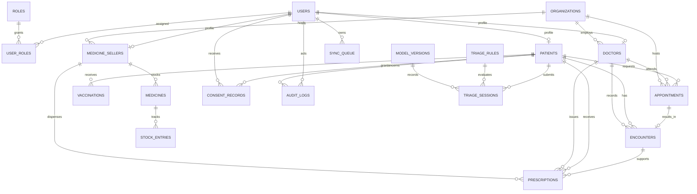

# Phase 1 data model

Synthea mapping remains pending until the actual CSV headers are supplied and inspected. The intended entities are listed in `README.md`; no columns are assumed in this phase.
