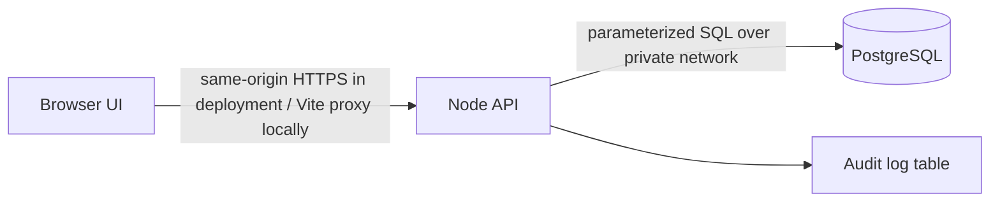

# Phase 1 threat model

## Data flow and trust boundaries

Browser input is untrusted. The API validates request bodies, hashes passwords with Argon2id, issues short-lived signed access tokens and rotating opaque refresh tokens, stores only a SHA-256 refresh-token digest, and sends session tokens in HttpOnly cookies. PostgreSQL should be private to the application network and credentials must be supplied through environment variables.

## Threats and current mitigations

| Threat | Mitigation in Phase 1 | Remaining work |
| --- | --- | --- |
| Password disclosure | Argon2id hashes; password never returned | Password reset and breached-password controls |
| Token theft / replay | HttpOnly, SameSite cookies; refresh rotation and revocation; short access lifetime | CSRF token / Origin policy for production deployment; key rotation |
| Brute force | Per-IP authentication rate limit | Shared rate-limit store and monitoring for multi-instance deployment |
| Horizontal / vertical privilege escalation | Server-side role check against `user_roles`; public registration restricted to patient | Endpoint-level record authorization and adversarial security tests in Phase 2 |
| SQL injection | Parameterized SQL in auth/data helpers | Security test suite in Phase 5 |
| Small-group re-identification | Policy requires admin aggregation and suppression under 5 | Analytics endpoints are not implemented yet |
| Unreviewed clinical guidance | No triage endpoint or active clinical rules shipped | Clinician-reviewed, cited rules and safety evaluation before clinical use |
| OTP guessing / delivery abuse | 6-digit random codes, HMAC digests, 10-minute expiry, five verification attempts, one send per minute and five per hour per phone/email pair | Add delivery monitoring, abuse alerts, and CAPTCHA/risk checks if the public app is exposed |

## Operational boundary

Use HTTPS, managed secret storage, database backups, least-privilege database credentials, and a private database network in deployment. The supplied compose defaults are local-development values only.
